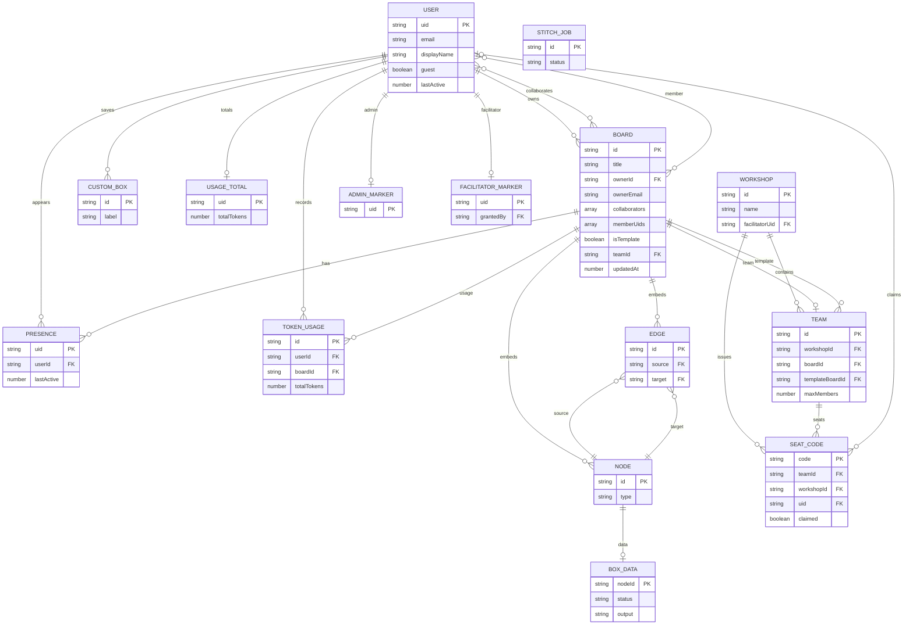

# Firestore Data Model

relay uses **Cloud Firestore**, a schemaless document database, so a strict relational ERD would
be misleading: there are no foreign keys, joins, or migrations. This document is the contract the
TypeScript types and the actual writers maintain. It combines an ER-style relationship view with
the real Firestore paths and document shapes.

## How to read this

- **PK** — the Firestore document id. It is not stored as a field.
- **FK** — a string reference to another document. It is a logical link, not a database constraint.
- **Embedded** — part of the parent document, not a separate collection.
- `?` — optional. Firestore documents omit missing fields rather than storing `null`.
- Timestamps are mixed by design: most app documents use **epoch milliseconds** (`number`);
  `tokenUsage` and `usageTotals` use **Firestore Timestamps** (`new Date()`); the legacy
  `stitchJobs` docs use **ISO strings**.

## Collection map

```text
boards/{boardId}
boards/{boardId}/presence/{uid}

users/{uid}
users/{uid}/boxes/{boxId}

tokenUsage/{autoId}
usageTotals/{uid}

workshops/{autoId}
teams/{autoId}
codes/{code}

admins/{uid}
facilitators/{uid}

stitchJobs/{jobId}          # legacy Functions path only; denied to clients
```

`boards/{boardId}` is the unit of persistence and collaboration. Nodes, edges, and per-box data are
**embedded** in that one document. There is no `nodes` or `boxes` collection.

## Relationship diagram

Logical relationships only. `NODE`, `EDGE`, and `BOX_DATA` are embedded in `BOARD`, not top-level
collections.



## Document schemas

### `boards/{boardId}`

Written by the browser (`saveBoard` / `updateBoardData`) and read via `getDoc` + `onSnapshot`.
`updatedAt` is also the echo-detection key for the local save/snapshot race guard.

| Field | Type | Notes |
|---|---|---|
| `title` | `string` | Board title |
| `ownerId` | `string` | Firebase Auth uid |
| `ownerEmail` | `string` | Denormalized owner email |
| `collaborators` | `string[]` | Email-based sharing; queried with `array-contains` |
| `memberUids` | `string[]` | UID-based membership for workshop guests; queried with `array-contains` |
| `isTemplate` | `boolean` | Facilitator template boards; excluded from the normal board list |
| `teamId` | `string` | `""` for normal boards; back-reference for team boards |
| `nodes` | `array` | Embedded React Flow nodes (see below) |
| `edges` | `array` | Embedded React Flow edges (see below) |
| `boxData` | `map` | Keyed by node id; per-box content and AI state |
| `createdAt` | `number` | Epoch ms |
| `updatedAt` | `number` | Epoch ms; every save stamps it |

Board lists are assembled from three queries: owned by `ownerId`, shared by
`collaborators array-contains email`, and guest-accessible by `memberUids array-contains uid`.

### Embedded graph: `nodes[]`, `edges[]`, `boxData`

`nodes` and `edges` are persisted React Flow objects, not normalized tables. React Flow may also
persist transient fields such as `selected`, `dragging`, or measured dimensions; the stable shape is:

| Entity | Field | Type | Notes |
|---|---|---|---|
| Node | `id` | `string` | Box id, or `area-…` for an area |
| Node | `type` | `string` | `BoxType` or `"area"` |
| Node | `position` | `{ x, y }` | Flow coordinates |
| Node | `data.boxType` | `string` | Box type; absent for areas |
| Node | `data.title` | `string` | Editable box title |
| Node | `data.customLabel` | `string?` | Custom box instance label |
| Node | `data.customIcon` | `string?` | Custom box emoji |
| Node | `data.customColor` | `string?` | Custom box accent |
| Node | `data.fill` / `data.border` | `string?` | Area colors |
| Node | `style.width` / `style.height` | `number` | Persisted size |
| Node | `zIndex` | `number?` | `-1` for areas so they render below boxes |
| Edge | `id` | `string` | React Flow edge id |
| Edge | `source` | `string` | Source node id |
| Edge | `target` | `string` | Target node id |
| Edge | `sourceHandle` / `targetHandle` | `string?` | Connection handle |
| Edge | `animated` | `boolean` | Set to `true` on connect |
| BoxData | *key* | `nodeId` | No entry for area nodes |

`deleteBox(id)` removes the node, every connected edge, and the `boxData[id]` entry. Areas have no
`boxData` entry.

### `boxData[nodeId]`

The shape varies by box type. All boxes share the core fields; type-specific fields are optional.

| Group | Field | Type | Notes |
|---|---|---|---|
| Core | `content` | `string` | Typed idea / description / task |
| Core | `prompt` | `string` | User prompt template |
| Core | `systemPrompt` | `string` | System prompt |
| Core | `output` | `string` | Text output |
| Core | `status` | `"idle" \| "running" \| "done" \| "error"` | Run state |
| Core | `error` | `string?` | Last error |
| Run | `tokens` | `{ promptTokens, completionTokens, totalTokens }?` | Last LLM call; cumulative across Agent turns |
| Run | `ranAt` | `number?` | Last attempted run (success or error) |
| Media | `imageData` | `string?` | Base64 preview; **stripped before Firestore save** |
| Media | `outputImage` | `string?` | Generated/uploaded image URL |
| Media | `documents` | `BoxDocument[]?` | Documents box files + extracted text |
| Media | `slides` | `Slide[]?` | Parsed slide deck |
| Code | `code` | `string?` | Generated JSX or Stitch HTML |
| Code | `changePrompt` | `string?` | UI Design change request |
| Code | `codeVersions` | `ArtifactVersion[]?` | Append-only code history |
| Code | `codeVersion` | `number?` | Current version number |
| Code | `deploy` | `DeployInfo?` | Last here.now publish |
| Agent | `agentSteps` | `AgentStep[]?` | Agent run transcript |
| Collab | `authorEmail` / `authorName` | `string?` | Note attribution |
| Collab | `labelColor` | `string?` | Label pill color |
| Timer | `timerDurationMs` | `number?` | Total duration |
| Timer | `timerStatus` | `"idle" \| "running" \| "stopped" \| "paused"?` | Timer state machine |
| Timer | `timerStartedAt` | `number?` | Epoch ms of current run |
| Timer | `timerRemainingMs` | `number?` | Frozen remaining time |
| Timer | `timerStartedBy` | `string?` | Attribution email |
| Checklist | `checklistItems` | `ChecklistItem[]?` | Shared team tasks |
| NBN | `handoffFrom` / `handoffTo` | `string?` | Handoff Brief roles |
| NBN | `reviewedBy` | `string?` | Handoff reviewer |
| NBN | `reviewedAt` | `number?` | Review timestamp |
| NBN | `jargonTerms` | `number?` | Terms counted under `## Terms Simplified` |
| Legacy | `handoffGeneratedAt` | `number?` | Old Handoff run timestamp |
| Legacy | `alignmentRanAt` | `number?` | Old Alignment run timestamp |

Nested shapes:

```ts
interface BoxDocument {
  id: string;
  name: string;
  size: number;
  ext: string;
  url: string;       // R2 public URL, or "" if upload failed
  text: string;      // extracted text, or "" on failure
  chars: number;
  truncated: boolean;
  error: string;
}

interface Slide {
  title: string;
  bullets: string[];
  notes?: string;
}

interface ChecklistItem {
  id: string;
  text: string;
  done: boolean;
  assignee: string;
  createdBy: string;
  createdAt: number;
  doneBy: string;
  doneAt: number;
}

interface AgentStep {
  id: string;
  type: "plan" | "add_box" | "connect" | "run" | "finish" | "stopped" | "error";
  label: string;
  detail?: string;
  boxId?: string;
  at: number;
}

interface ArtifactVersion {
  version: number;
  content: string;
  createdAt: number;
  createdBy: string;
  source: "generated" | "edited";
  note: string;
}

interface DeployInfo {
  slug: string;
  url: string;
  versionId: string;
  claimToken: string;
  claimUrl: string;
  anonymous: boolean;
  expiresAt: string;
  deployedAt: number;
  fileCount: number;
  bytes: number;
  warnings: string[];
  error: string;
}
```

### `boards/{boardId}/presence/{uid}`

Ephemeral collaboration state. One doc per user per board.

| Field | Type | Notes |
|---|---|---|
| `userId` | `string` | Same as the doc id |
| `email` | `string` | Display/roster key |
| `displayName` | `string` | Roster name |
| `initials` | `string` | Avatar initials |
| `color` | `string` | Cursor/avatar color |
| `cursorX` / `cursorY` | `number` | Flow coordinates |
| `lastActive` | `number` | Epoch ms; entries older than 30s are filtered out |

Cursor writes are throttled to 200ms; a heartbeat refreshes `lastActive` every 15s. The client derives
`hasCursor` from whether `cursorX` exists; it is not stored.

### `users/{uid}`

Profile and guest record. Written by the browser on login and by the legacy workshop-join function.

| Field | Type | Notes |
|---|---|---|
| `email` | `string` | Empty for guests without an email |
| `displayName` | `string` | |
| `photoURL` | `string` | Google profile image; empty for guests |
| `createdAt` | `number` | Epoch ms; preserved on re-login |
| `lastActive` | `number` | Epoch ms; heartbeat every 60s |
| `guest` | `boolean?` | Workshop guest marker |
| `teamId` | `string?` | Guest's team |
| `workshopId` | `string?` | Guest's workshop |
| `code` | `string?` | Seat code used |
| `namePickedAt` | `number?` | When the guest completed their profile |

### `users/{uid}/boxes/{boxId}`

Saved custom box templates. These are definitions, not live board boxes.

| Field | Type | Notes |
|---|---|---|
| `label` | `string` | Template name |
| `icon` | `string` | Emoji |
| `color` | `string` | Hex accent |
| `description` | `string` | |
| `prompt` | `string` | Prompt template |
| `systemPrompt` | `string` | System prompt |
| `createdAt` / `updatedAt` | `number` | Epoch ms |

When a custom box is added to a board, its prompt, system prompt, label, icon, and color are **copied**
onto the board node/`boxData`. There is no live reference back to the saved definition.

### `tokenUsage/{autoId}` and `usageTotals/{uid}`

Token accounting is written by the browser after a successful LLM call.

`tokenUsage/{autoId}`:

| Field | Type | Notes |
|---|---|---|
| `userId` | `string` | Firebase Auth uid |
| `boardId` | `string` | May be `""` outside a board |
| `boxId` | `string` | |
| `boxType` | `string` | Client-supplied box type |
| `model` | `string` | Model returned by the API |
| `promptTokens` | `number` | Ollama `prompt_eval_count` |
| `completionTokens` | `number` | Ollama `eval_count` |
| `totalTokens` | `number` | Sum |
| `createdAt` | `Timestamp` | Firestore Timestamp (`new Date()`) |

`usageTotals/{uid}`:

| Field | Type | Notes |
|---|---|---|
| `promptTokens` | `number` | Atomic `increment()` |
| `completionTokens` | `number` | Atomic `increment()` |
| `totalTokens` | `number` | Atomic `increment()` |
| `updatedAt` | `Timestamp` | Firestore Timestamp |

`tokenUsage` is append-only. `usageTotals` is the per-user rollup used by the header badge and the
Admin board. The client writes both; the server does not validate them.

### `workshops/{autoId}`

| Field | Type | Notes |
|---|---|---|
| `name` | `string` | |
| `description` | `string` | |
| `facilitatorUid` | `string` | Owner/facilitator |
| `facilitatorEmail` | `string` | Denormalized |
| `createdAt` | `number` | Epoch ms |

### `teams/{autoId}`

A team is a workshop instance copied from a template board.

| Field | Type | Notes |
|---|---|---|
| `workshopId` | `string` | Parent workshop |
| `workshopName` | `string` | Denormalized copy |
| `name` | `string` | Team name |
| `boardId` | `string` | Team board; initially `""`, updated after the board is saved |
| `templateBoardId` | `string` | Source template board |
| `facilitatorUid` | `string` | |
| `maxMembers` | `number` | 5 |
| `createdAt` | `number` | Epoch ms |

The team board is a **copy** of the template's nodes/edges/boxData, not a live link. Deleting the
template does not affect existing teams.

### `codes/{code}`

Top-level seat-code documents. The doc id is the 8-character code, so the join endpoint can fetch it
with a direct `getDoc` and no query/index.

| Field | Type | Notes |
|---|---|---|
| `code` | `string` | Same as the doc id |
| `teamId` | `string` | |
| `workshopId` | `string` | Denormalized |
| `uid` | `string?` | Set when claimed |
| `claimed` | `boolean?` | Set when claimed |
| `claimedAt` | `number?` | Epoch ms |

Codes are created unclaimed, five per team. A claimed code is bound to one durable guest uid. The
legacy join function counts claimed codes for capacity.

### `admins/{uid}` and `facilitators/{uid}`

Marker documents. Existence is the role check; the client reads its own marker to show the button.

- `admins/{uid}` — manually created via the Firebase console or a script. No required fields.
- `facilitators/{uid}` — `grantedBy: string`, `grantedAt: number`. Written by the legacy admin
  role endpoint.

### `stitchJobs/{jobId}` — legacy Functions path

Not used by the Render server, which keeps Stitch jobs in an in-memory `Map`. The legacy Functions
path stores them in Firestore and processes them with Cloud Tasks.

| Field | Type | Notes |
|---|---|---|
| `status` | `"queued" \| "running" \| "done" \| "error"` | |
| `prompt` | `string` | |
| `createdAt` | `string` | ISO timestamp |
| `updatedAt` | `string?` | ISO timestamp |
| `html` | `string?` | Generated Stitch HTML |
| `imageUrl` | `string?` | Screenshot URL |
| `error` | `string \| null?` | `null` on success |

## Referential integrity and write behavior

Firestore does not enforce any of the links above. The application does:

- `deleteBox(id)` removes the node, connected edges, and its `boxData` entry.
- `deleteBoard(id)` deletes the board document. Firestore does **not** cascade-delete its `presence`
  subcollection, so orphaned presence docs are possible.
- `deleteTeam(team)` deletes the team's codes, the team doc, and the team board. It does not delete
  the workshop or the template board.
- `deleteWorkshop(id)` deletes only the workshop doc; teams are not cascaded.
- Deleting a custom box definition never affects board instances because the fields were copied.
- Deleting a template board never affects team boards because the content was copied.

## Firestore limits and serialization rules

- **1 MB per document.** The whole board is one document, so the model is deliberately compact:
  base64 `imageData` is stripped before saving; Documents-box text is capped at 100k chars per file
  and 400k chars per box; code history is append-only and can grow over time.
- **No `undefined`.** `cleanBoxDataForFirestore` removes `undefined` values before every save.
  Nested records such as `BoxDocument`, `ChecklistItem`, and `DeployInfo` keep every field defined.
- **No migrations.** Old boards may lack newer fields; readers default missing values and
  normalization helpers repair legacy data (for example, `normalizeChecklist`).
- **Mixed timestamp formats.** See the note at the top — do not assume every date field is the same
  type.

## Access control (actual rules)

Board content never passes through the Express API: the browser reads and writes Firestore directly.
Firestore rules are therefore the access-control layer for board data. The Admin SDK routes in the
legacy Functions path bypass rules by design.

| Path | Read | Write |
|---|---|---|
| `boards/{boardId}` | Any authenticated user | Create: owner; update: any authenticated user; delete: owner |
| `boards/{boardId}/presence/{uid}` | Any authenticated user | Own doc only |
| `users/{uid}` | Self only | Self only |
| `users/{uid}/boxes/{boxId}` | Self only | Self only |
| `admins/{uid}` | Self only | Admin SDK only |
| `facilitators/{uid}` | Self only | Admin SDK only |
| `workshops/{id}` | Any authenticated user | Facilitator who owns it |
| `teams/{id}` | Any authenticated user | Facilitator who owns it |
| `codes/{code}` | Facilitator of the team | Facilitator of the team |
| `tokenUsage/{id}` | Own records (write-only in practice — see below) | Own records |
| `usageTotals/{uid}` | Self only | Self only |
| `stitchJobs/{id}` | Denied to clients | Denied to clients |

> **Current sharp edge:** the `boards` rule is explicitly marked temporary and allows any
> authenticated user to read or update any board. The data model supports per-owner/collaborator
> access, but the deployed rules do not enforce it yet.
>
> **Rule quirk:** the `tokenUsage` read rule references `request.resource.data.userId`, which is
> not available on reads, so it effectively denies reads. This has no user-visible effect today
> because the client only writes `tokenUsage`; the Admin board aggregates `usageTotals` instead.
