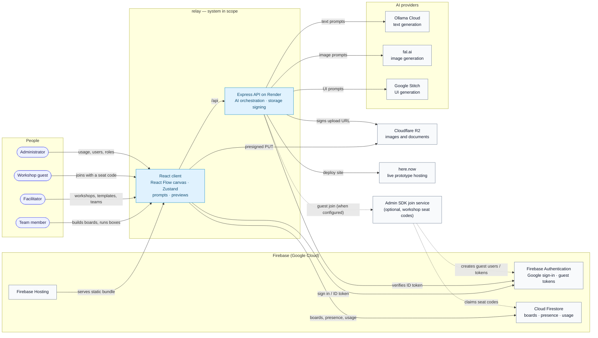

# System Context

A C4-style **system context** view of relay. The system boundary contains the React client and
the Express API; everything outside it is a person or an external service.

> **Legend:** solid arrows are active in the current deployment; dashed arrows are optional or
> conditional. The current deployment does not use Cloud Functions, so the optional Admin SDK join
> service is only available when a standalone service is configured through `WORKSHOP_PROXY_URL`.

## People

| Actor | What they do | Main interactions |
|-------|--------------|-------------------|
| **Team member** | Creates boards, adds boxes, writes prompts, runs AI, collaborates live | Client → API, Firestore, R2 |
| **Facilitator** | Creates workshops, templates, teams, and seat codes; runs the team board | Client → Firestore; API for AI |
| **Workshop guest** | Joins a team with a seat code, picks a display name, edits the team board | Client → Auth, Firestore, API; optional join service |
| **Administrator** | Views system usage and manages users and roles | Client → API (`/api/admin/*`) |

## External systems & services

| External system | Why relay uses it | Relationship |
|-----------------|-------------------|--------------|
| **Firebase Hosting** | Serves the static React client | HTTPS static hosting |
| **Render** | Hosts the Express API (`server/`) | Web service; the browser calls `VITE_API_BASE` |
| **Firebase Authentication** | Google sign-in, Firebase ID tokens, guest custom tokens | Firebase SDK from the client; token verification in the API |
| **Cloud Firestore** | Boards, box data, presence, usage totals, token ledger | Firebase SDK from the client; Admin SDK from the optional join service |
| **Cloudflare R2** | Board images and Documents-box originals | Browser uploads with a presigned PUT; the API signs the URL |
| **Ollama Cloud** | Text generation for Research, PRD, Slides, UI, Agent, and custom boxes | API → Ollama `/api/chat` |
| **fal.ai** | Cartoon/image generation | API → fal.ai models |
| **Google Stitch** | Stitch UI screen generation | API → Stitch SDK; the client polls the async job |
| **here.now** | Publishes UI/Stitch boxes as live sites | API → here.now create → upload → finalize |
| **Admin SDK join service** *(optional)* | Redeems workshop seat codes and mints guest custom tokens | API proxy → service; service → Auth + Firestore |
| **Public CDNs** *(preview only)* | Load React, Babel, Tailwind, and Google Fonts in sandboxed preview iframes | Browser iframe → CDN |

## Trust and data notes

- The browser never holds Cloudflare R2 credentials; it receives a short-lived presigned PUT URL
  from the API.
- Firebase ID tokens authenticate storage signing and admin routes.
- The client writes boards and presence directly to Firestore; the API is not in that path.
- AI requests and here.now deploys go through the API, so provider keys never reach the browser.
- Admin and workshop writes need the Firebase Admin SDK. On the current Render service those
  routes return `501` unless an Admin SDK service/proxy is configured.
